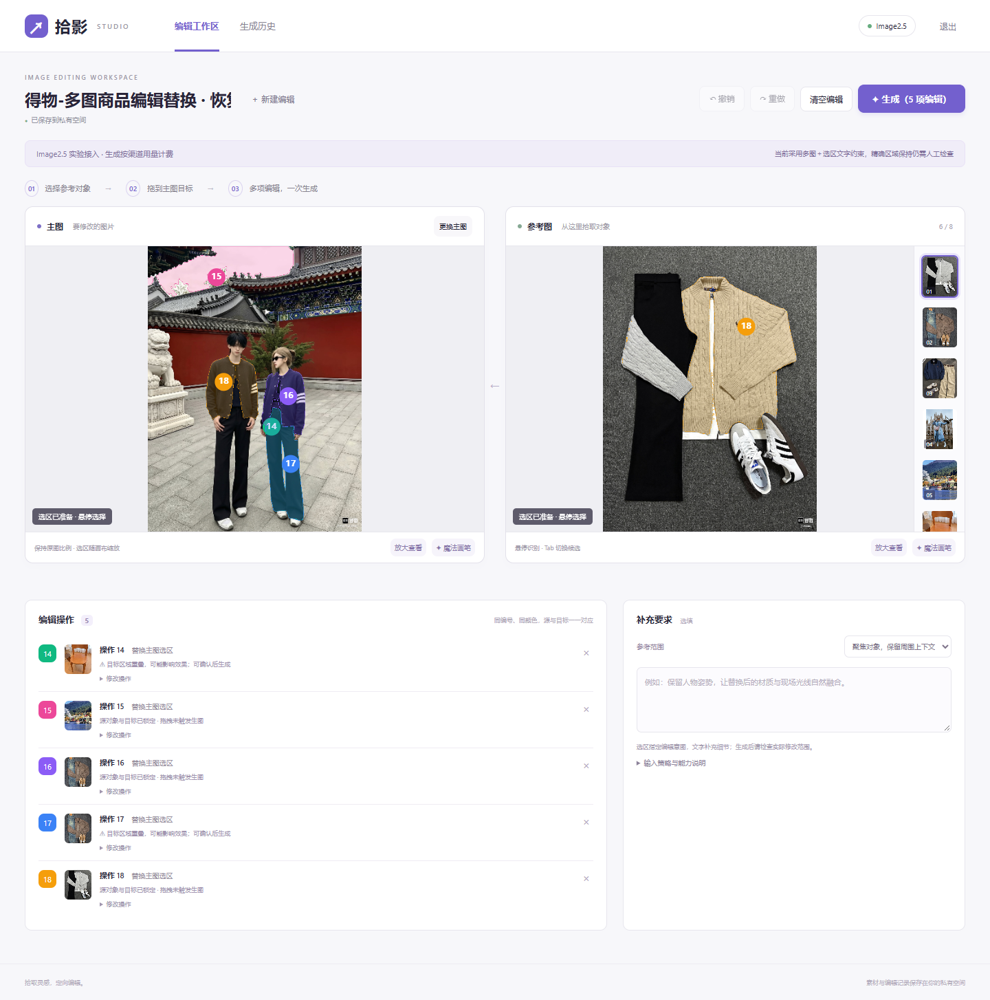
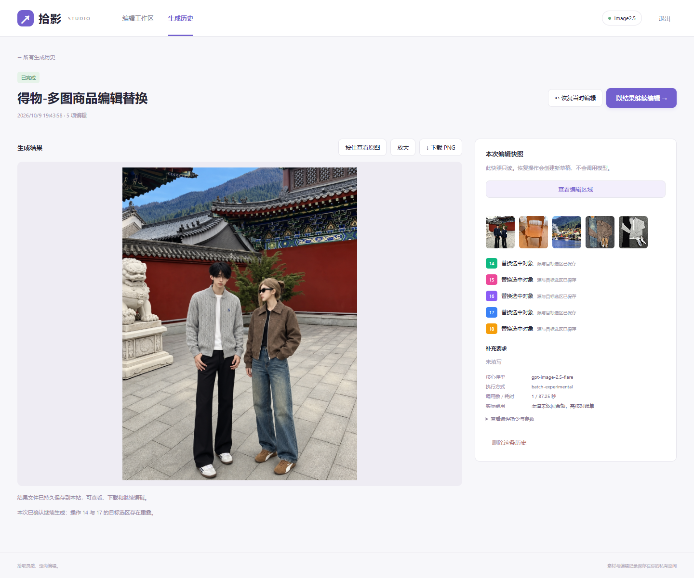

# 拾影 · 独立 Image2.5 图像编辑网站

## 页面预览

### 多图编辑工作区



### 生成结果与编辑快照



这是可独立运行的单使用者私有网站，包含双图编辑工作区、服务端草稿、生成历史、稳定详情地址、下载、恢复原编辑和以结果继续。真实图像编辑仅使用 **65535 / gpt-image-2.5-flare**，不会自动换模型。没有生产部署。

当前版本是**有真实调用证据的工程试用版**，不是完整质量验收通过版。详见 [TECH_RESEARCH.md](TECH_RESEARCH.md)、[CHECKS.md](CHECKS.md) 和 [真实图像检查](evidence/QUALITY_REVIEW.md)。

## 本机启动

本机已生成私有 `.env`，API Key 仅在服务端读取。空间登录信息见未纳入版本控制的 `LOCAL_ACCESS.md`。

```powershell
cd 'E:\image多图编辑新交互'
python -m pip install -r requirements.txt
python -m pip install -r requirements-segmentation.txt
python scripts/download_segmentation.py
python run.py
```

访问 <http://127.0.0.1:8787>。前端无需 Node 构建或单独服务器。后端 Python 3.12；本机真实分割使用 Quadro T2000 Max-Q，PyTorch 2.5.1+cu121、Transformers 5.12.1。

Windows 后台启动可运行 `powershell -ExecutionPolicy Bypass -File .\start.ps1`；输出进程 ID，日志在 `data/server.stdout.log` 和 `data/server.stderr.log`。不要重复启动占用同一端口。

另一台机器首次安装：复制 `.env.example` 为 `.env`，设置不少于 12 字符的 `SITE_PASSWORD`；填入用户自己的 `IMAGE25_API_KEY` 和 `IMAGE25_MODEL`。不要复制本机密钥到代码或前端。没有模型文件时会明确显示真实分割未配置，仍可手动圈选；不会伪造 AI 选区。

## 配置

| 配置 | 作用 |
|---|---|
| `SITE_PASSWORD` | 单一授权使用者的空间密码。签发 HttpOnly 会话，资料/图片下载均需鉴权 |
| `DATA_DIR` | 持久目录，默认项目下 `data`，必须可写 |
| `GENERATION_MODE` | `simulation`：仅保存流程检查记录，无图像输出；`live`：真实付费生成 |
| `IMAGE25_BASE_URL` | 65535 origin，不带 `/v1`，默认 `https://task-api-1-cn.65535.space` |
| `IMAGE25_API_KEY` | 服务端 API Key |
| `IMAGE25_MODEL` | 当前复测模型 `gpt-image-2.5-flare`。指定模型不可用则阻塞，禁止替换 |
| `SEGMENTATION_DEVICE` | 默认 `cpu`，避免 Windows CUDA 驱动在并发悬停请求中触发进程级崩溃；确认 CUDA 稳定后可显式设为 `cuda` |
| `IMAGE25_EXPERIMENTAL` | 真实模式还需 `true`，明确接受 TECH_RESEARCH 中的质量限制 |
| `SOURCE_STRATEGY` | 初始建议 `context-crop`；工作区可改为 `full`，原图始终保存 |
| `IMAGE25_QUALITY` | 默认不传；不要用未经本渠道验证的任意值 |
| `SEGMENTATION_MODEL_DIR` | 本地 SlimSAM 模型目录，默认 `.models/slimsam` |
| `HOST` / `PORT` | 默认 `127.0.0.1` / `8787` |
| `COOKIE_SECURE` | HTTPS 部署设 `true`，本机 HTTP 使用 `false` |

真实模式会在提交前自检 `/v1/models` 和 `/v1/pricing`。站内提交按草稿 ID＋已保存 revision 幂等；响应丢失后刷新不会重复扣费。需要明确再生成时，从原历史恢复为新草稿后提交。

## 操作

1. 左侧上传一张主图，右侧最多十二张参考图（主图不计入）。图片按 EXIF 校正方向并转为本站 PNG 资产。
2. 在参考对象上停留，看到真实分割候选后拖拽；Tab 切换候选。源与目标均支持手动圈选：按住鼠标连续画线，松开自动闭合，Esc 取消。圈选不会生图，源选区完成后仍需拖到主图。
3. 落点选区未准备好时进入“待确认目标”。取消或 Esc 不创建关系。最多可起草二十条元素 Mapping，编号不因删除而重排，支持撤销/重做；生成时元素裁剪与明确 @ 的整图共享 12 个实际参考输入上限，超限会阻止提交且不会静默丢弃。
4. 统一点击生成。目标选区重叠时提示相关编号与效果风险，可选择“返回调整”或“仍要生成”；确认仅适用于本次提交，并记录在历史中。同目标重复拖拽可选择“保留两条关系”“替换原操作”或取消；仍遵循最多 20 条元素草稿。不同落点分别保存并写入文字编辑意图，不代表官方精确放置参数。短标签选填，不影响选区。
5. 任务在后台执行。历史 `/history/{id}` 可直接打开、刷新、放大、对比和下载；恢复建立新草稿，原快照不修改。

历史详情保留完整结果和右侧快照。“查看编辑区域”按钮会在详情页下方展开当时的原始主图、彩色选区及编号角标，可切换查看参考图的源选区；再次点击“隐藏编辑区域”收起。点击区域图还可放大。展示的是输入意图，不是生成结果的实际修改边界。

详情图片点击可放大，滚轮围绕鼠标位置缩放，按住拖动查看，支持“适应窗口”和 Esc 关闭。工作区点击图片或“放大查看”打开无边框单图浮层，只显示当前图片和底部半透明操作条；默认拖动查看，开启“魔法画笔”后系统准星替换为带流动渐变与闪光的紫色笔，按住圈画、松开自动保存选区并返回工作区，再拖拽建立关系。工作区的原手动圈选按钮也改名为“魔法画笔”。历史列表点击图片或标题均直接进入完整历史详情页。查看操作不生图、不修改历史。

用户不需要逐条编写 Prompt。实际指令从 Mapping 编译，原生 Mask 默认关闭，区域目前由参考对象与文字区域约束表达。该方式不能保证只修改选区内像素。

## 持久化

```text
data/
  editor.sqlite          SQLite WAL 元数据、草稿、历史快照、会话
  assets/                原主图、参考图、原始 Mask、裁剪、结果和缩略图
```

上游结果 URL 只用于服务端转存和失败恢复，不是历史图片地址。成功状态必须在结果字节落盘后才写入。保存异常的“重试保存”不会调用图像模型。临时 URL 已过期且从未存到本站的结果仍可能丢失，会保留错误，不能假称恢复成功。

进程重启：排队任务继续；已完成并进入保存阶段的任务继续转存；同步请求中途被中断的任务标为“状态待核对”，不自动重发。实测编辑返回的 generation_id 不能直接用 `/v1/tasks/{id}` 查到，因此状态未知目前需到渠道侧核对，没有自动续跑承诺。

历史逻辑删除，不删除共享资产。暂未提供实体垃圾回收和容量自动清理。部署方应监控磁盘容量。

## 部署（仅说明，未上线）

推荐单实例 Linux 服务或有持久卷的容器；**一个 Uvicorn worker**，不支持多副本共享同一磁盘队列。生产须 HTTPS、强密码、`COOKIE_SECURE=true` 和稳定的 DATA_DIR；禁止放到无持久保证的临时磁盘。当前不是多人账户系统，不能用共享密码冒充多人隔离。

```sh
docker build -t shiying-editor .
docker run --name shiying --restart unless-stopped \
  --env-file .env -e HOST=0.0.0.0 -e DATA_DIR=/data \
  -e SEGMENTATION_MODEL_DIR=/models/slimsam \
  -p 127.0.0.1:8787:8787 \
  -v /srv/shiying/data:/data -v /srv/shiying/models:/models:ro \
  shiying-editor
```

此 Dockerfile 默认 CPU 分割，性能另测；GPU 部署需匹配 CUDA/PyTorch 容器运行环境。把已经下载的 `.models/slimsam` 复制到模型持久目录。反向代理仅公开站点端口，不能直接公开 `/data`。示例仅供实施，未执行镜像构建或上线。

备份：停止服务后一起复制完整 DATA_DIR，再启动。也可在线使用 SQLite backup API 及一致的资产快照；不可只复制打开中的 sqlite 主文件而丢失 WAL。回退：停止服务，恢复同一批数据库＋assets，保留对应代码版本。当前 schema 初始化是幂等建表；未来字段变更需显式迁移，切勿删除数据库“重新初始化”。

## 检查与实验

```powershell
python -m pip install -r requirements-test.txt
python -m playwright install chromium
python -m pytest tests/test_backend.py -q -p no:cacheprovider
node --test tests/core.test.mjs
python scripts/browser_check.py
python scripts/channel_probe.py
```

`browser_check.py` 使用隔离的测试目录和端口 8788，不调用付费生成；会实际关闭浏览器和重启自己的测试服务。

`performance_check.py` 测量本机正在运行的网站，使用真实分割但不生图。真实历史重启核验：运行 `real_history_check.py --phase before`，重启网站，再运行 `--phase after`；后者会创建恢复草稿，验证全部真实记录字节、下载与恢复，保留历史不变。

以下是**会产生真实费用**的实验命令，仅在你有对应授权和配置时运行。已经有同名记录的实验不会自动重复请求。

```powershell
python scripts/real_experiments.py --phase minimal
python scripts/real_experiments.py --phase compare
# 检查第一步输出目标漂移后，才可运行串行第二步：
python scripts/real_experiments.py --phase serial-second
python scripts/real_experiments.py --phase quality
python scripts/real_experiments.py --phase mask
python scripts/label_experiments.py
```

`evidence/real` 保存固定输入状态、原始/派生 Mask 参数、实际编译输入资产 ID、输出 PNG、请求 ID 和耗时。素材归因见 `evidence/samples/public-sources.json`，仅作为本项目技术验证材料，没有公开部署或营销发布。
